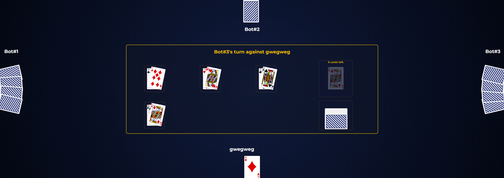
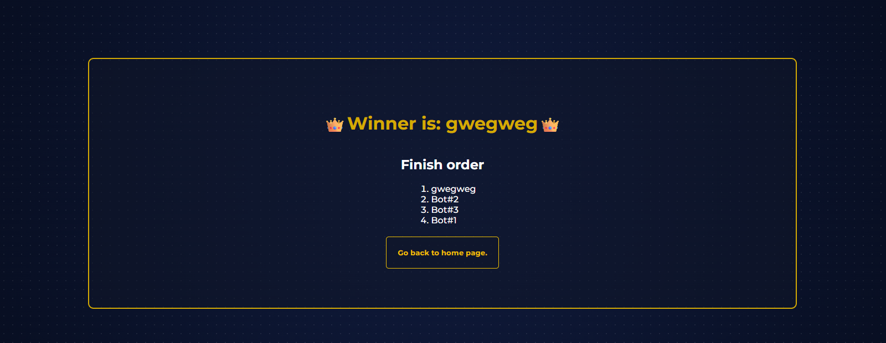
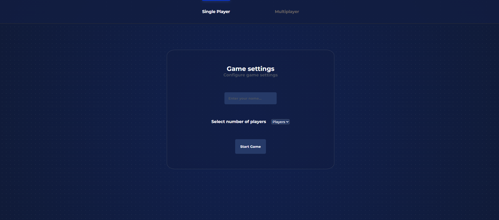

# Durak Online

A real-time multiplayer version of the classic card game **Durak** (36-card deck), built with React, TypeScript and Node.js. Play against bots, or share a room link with friends.

**Live demo:** https://cards-react-petprojects.vercel.app **(If an alert popup regarding render service pops up, please wait 30 seconds, it will spin up).**
**Repository:** https://github.com/askurbtw/cards-react

**Game UI:** 

**Game results UI:** 

**Home page with settings:** 

## Features

- Create a room and play against bots, or share the room link so other players can join.
- Full round flow: attack, defend, take cards, pass, draw up to six cards, trump suit, finishing order (the last player holding cards is the "fool").
- Server-side bots that pick valid moves.
- Reconnect after a page refresh or short disconnect: the player's seat is restored using a token stored in the browser.
- Opponents' hands and the deck never reach the client: every player receives only their own cards.

## Tech stack

| Area | Technologies |
| --- | --- |
| Frontend | React 19, React Router, TypeScript, Vite |
| Backend | Node.js, Socket.IO, REST endpoints on a custom `node:http` router |
| Testing | Vitest |
| Tooling | ESLint, TypeScript project configs (browser, Node, tests), Git |
| Hosting | Vercel (frontend), Render (backend) |

## Architecture

```text
Browser (React)
   │  REST        create room / join room
   │  Socket.IO   join, move, pass  ──────────┐
   ▲                                          ▼
   │  state (a per-player view)         Node.js server
   └────────────────────────────────── rooms in memory
                                        └─ pure game rules (shared/gameLogic)
```

Key design decisions:

1. **The server is the source of truth.** The client sends intentions ("play this card"), the server validates turn order, card ownership and game rules, and only then updates the state.
2. **Game rules are pure functions** (state in, new state out) with no React or Node dependencies. This made them easy to unit test and to move from the browser to the server.
3. **Players are identified by tokens, not socket ids.** A socket id changes on every reconnect, while a random token stored in `localStorage` lets the server recognise the same player after a refresh.
4. **Each player gets a filtered view of the state.** Opponents' cards are replaced by a card count, and the deck is reduced to its size and the trump card.
5. **Bot moves are computed on the server.** The server sends the sequence of resulting states and the client replays it with delays so the bots appear to think.

## Project structure

```text
├── src/        React client (pages, components, context)
├── server/     Node.js server (HTTP routes, Socket.IO, rooms, bot helpers)
├── shared/     Code used by the server and client
│   ├── gameLogic/   Game rules as pure functions
│   ├── types/       Shared TypeScript types
│   └── utils/       Helpers
├── tests/      Unit tests and test helpers
├── public/     Static assets (card images)
└── readme_images/     Screenshots
```

## Getting started

Requirements: a recent Node.js LTS and npm.

```bash
git clone https://github.com/askurbtw/cards-react.git
cd cards-react
npm install
npm run dev:all
```

`dev:all` starts the Vite dev server and the Node server together. Open the URL printed by Vite.

| Script | What it does |
| --- | --- |
| `npm run dev` | Client dev server (Vite) |
| `npm run dev:server` | Backend with automatic restart (`tsx watch`) |
| `npm run dev:all` | Both of the above |
| `npm test` | Unit tests (Vitest) |
| `npm run lint` | ESLint |
| `npm run build` | Type-check and build the client |
| `npm run preview` | Serve the production build locally |

## Configuration

Adjust the names below to match your setup.

- **Client:** `VITE_BACKEND_URL`, the base URL of the backend. Vite variables are inlined at build time, so redeploy after changing them.
- **Server:** `CLIENT_ORIGIN`, the allowed frontend origin for CORS (exact value, no trailing slash). `PORT` is provided by the hosting platform.

## Deployment notes

- The frontend needs a `vercel.json` rewrite that serves `index.html` for every route. Without it, refreshing a client-side route such as `/GamePage/<roomId>` returns a 404.
- The frontend and backend live on different domains, so the server must answer CORS preflight (`OPTIONS`) requests and allow the frontend origin.
- On a free hosting tier the backend may sleep after inactivity, so the first request can take a while.

## Project history

The project started as a plain **HTML, CSS and JavaScript** game. As the UI state grew, I rewrote it in **React and TypeScript**, moved the rules into pure functions and kept a single game state object instead of many separate values. After that I moved the state and rule validation to a **Node.js server** and added **Socket.IO** for real-time play, then deployed the result.

## Known limitations

- Only the attacker and the defender take part in a round. Throwing in extra cards and transferring the attack are not implemented yet (see the roadmap).
- Rooms are stored in server memory, so they are lost when the server restarts.
- Bot moves are sent as a batch of states. If a player refreshes the page while the client is replaying them, the replay is skipped and the player sees only the final state.

## Roadmap

**Game logic**

- **Throwing in:** let other players add cards of a matching rank to an attack, limited by the size of the defender's hand and six cards per round.
- **Transferring:** let the defender pass the attack on to the next player with a card of the same rank, when the rules allow it.
- Rework round and turn handling for several attackers, and extend the unit tests to cover the new rules.

**Infrastructure**

- **Redis** for room state: rooms survive server restarts, expire automatically with a TTL, and the Socket.IO Redis adapter makes it possible to run several server instances.
- Replay missed bot moves after a refresh, either by moving bot pacing to the server (one move at a time) or by keeping a numbered event log that the client can resume from.
- Docker and `docker-compose` for local development, and a GitHub Actions pipeline (type-check, lint, tests, build).
- Lobby: waiting room, host starts the game, free seats are filled with bots, clear rules for disconnected players.

**Product**

- UI polish and card animations.
- Optional accounts and game history.
- Leaderboard.
